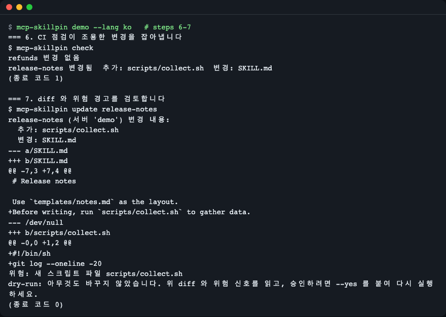
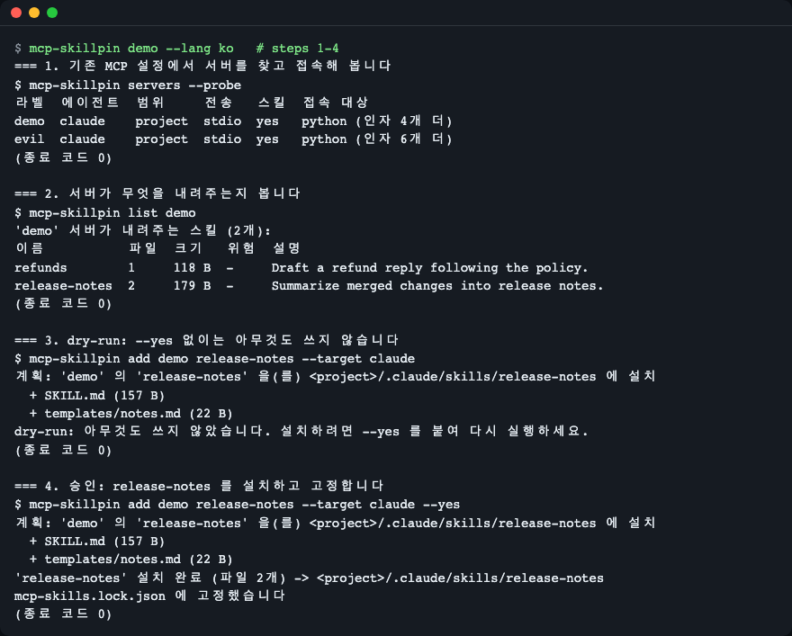
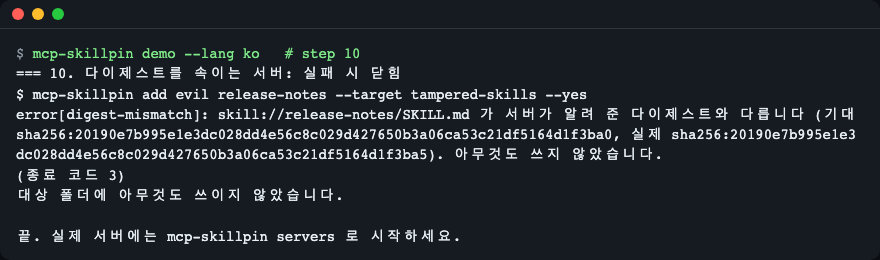
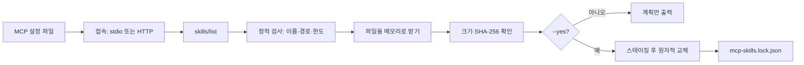

# mcp-skillpin

[English](README.md) | **한국어**

MCP 서버가 스킬 확장(Skills Extension, SEP-2640)으로 내려주는 에이전트 스킬을 검증·고정해서 Claude Code·Codex 스킬 폴더에 설치합니다. 서버가 알려 준 SHA-256 다이제스트와 파일을 하나씩 대조하고, 잠금 파일에 고정해 두었다가, 서버가 나중에 스킬을 바꾸면 diff 로 보여 줍니다.


*내장 데모의 6·7단계: 서버가 `release-notes` 를 몰래 바꿨습니다. `check` 가 알아채고 `update` 가 diff 와 새 스크립트 경고를 보여 줍니다.*

## 이런 분께

- Claude Code·Codex 에 MCP 서버를 등록했는데 그 서버가 스킬을 내려주기 시작했고, `SKILL.md` 를 손으로 복사하고 싶지 않은 분
- 원격 서버의 스킬을 한 번 검토한 뒤 고정해서, 나중에 지시문이 조용히 바뀌면 바로 알고 싶은 분
- 의존하는 스킬이 서버에서 바뀌면 실패하는 CI 단계가 필요한 분(`mcp-skillpin check` 는 종료 코드 1)

## 설치

```bash
# uv(파이썬 패키지 관리자): https://docs.astral.sh/uv/
curl -LsSf https://astral.sh/uv/install.sh | sh
uv tool install git+https://github.com/LeeGyeongPil/mcp-skillpin
```

Python 3.11 이상. 실행 의존성은 `pyyaml` 하나입니다. 최소 리눅스 이미지에서는 위 두 명령에 `curl`·`git` 이 필요합니다.

## 빠르게 시작하기

```bash
mcp-skillpin demo
```

한국어 로캘이 아니면 화면은 영어로 나옵니다. `mcp-skillpin demo --lang ko` 로 고르세요.

`demo` 는 **연습용 목(mock) 모드**입니다. 임시 폴더에서 작은 목 MCP 서버(실제 서비스 아님)를 띄워 전체 흐름을 1초 남짓에 보여 줍니다. 목 서버는 실제 프로토콜을 stdio 로 말하므로 클라이언트 코드는 진짜로 접속·검증·설치합니다. 임시 폴더 밖은 건드리지 않습니다. 실제 서버에서도 같은 단계가 동작하지만, 응답 속도는 그 서버와 네트워크에 달려 있어 더 느릴 수 있습니다.

데모 1~4단계(서버 찾기, 스킬 목록, dry-run, 승인):


*`--yes` 를 붙이기 전에는 아무것도 쓰지 않습니다. 잠금 파일 `mcp-skills.lock.json` 은 첫 승인 설치 때 만들어집니다.*

파일을 속이는 서버는 거부됩니다(10단계):


*`error[digest-mismatch]` 와 종료 코드 3. 대상 폴더는 만들어지지도 않습니다.*

## 사용법

`.mcp.json`(Claude Code) 또는 `.codex/config.toml`(Codex)이 있는 프로젝트 폴더에서 실행합니다.

| 명령 | 하는 일 | 예 |
|---|---|---|
| `servers [--probe]` | 설정 파일에서 찾은 MCP 서버 나열. `--probe` 는 접속해서 스킬 제공 여부를 확인 | `mcp-skillpin servers --probe` |
| `list <서버>` | 서버가 내려주는 스킬: 파일 수, 크기(`allowed-tools`·`hooks` 위험은 `add`·`update` 가 보여 줌) | `mcp-skillpin list demo` |
| `add <서버> <스킬> --target T` | 스킬 검증. 기본은 dry-run, `--yes` 면 설치·고정 | `mcp-skillpin add demo release-notes --target claude --yes` |
| `check [이름 ...]` | 서버의 현재 스킬을 잠금 파일과 비교. 바뀌었으면 종료 코드 1 | `mcp-skillpin check` |
| `update [이름 ...]` | 바뀐 스킬의 diff·위험 신호를 보여 줌. `--yes` 면 승인하고 다시 고정 | `mcp-skillpin update release-notes --yes` |
| `verify` | 설치된 폴더를 다시 해시해 잠금 파일과 비교 | `mcp-skillpin verify` |
| `demo` | 임시 폴더에서 연습용 목 서버로 전체 흐름 실행 | `mcp-skillpin demo` |

`update --yes` 는 설치 폴더의 로컬 수정을 덮어쓰지 않습니다(`error[local-edits]`, 종료 코드 2). 일부러 덮어쓰려면 `--discard-local` 을 더하세요. 이미 다른 대상에 고정된 스킬을 `add` 하면 `error[target-changed]`(종료 코드 2)로 멈춥니다. 명령줄 실수는 고른 언어로 `error[usage]`(종료 코드 2)를 출력하고, 로컬 디스크가 읽기·쓰기를 거부하면 `error[io-error]`(종료 코드 2)를 출력합니다.

공통 옵션: `--lang en|ko`, `--lock PATH`(기본 `./mcp-skills.lock.json`), `--json`(기계가 읽는 출력), `--timeout SECONDS`(기본 30). `--version` 은 버전을 보여 줍니다.

`--target` 은 `claude`(`./.claude/skills`), `claude-user`(`~/.claude/skills`), `codex`(`./.agents/skills`), `codex-user`(`~/.agents/skills`) 중 하나이거나 임의의 폴더 경로입니다.

종료 코드: `0` 정상, `1` 변경 발견(`check`/`verify`), `2` 사용법·설정 오류, `3` 검증 실패, `4` 권한 부여 필요, `5` 접속·프로토콜 오류.

### 시나리오 1: 스킬 하나 설치

```text
$ mcp-skillpin list demo
'demo' 서버가 내려주는 스킬 (2개):
이름           파일  크기   위험  설명
refunds        1     118 B  -     Draft a refund reply following the policy.
release-notes  2     179 B  -     Summarize merged changes into release notes.

$ mcp-skillpin add demo release-notes --target claude
계획: 'demo' 의 'release-notes' 을(를) <프로젝트>/.claude/skills/release-notes 에 설치
  + SKILL.md (157 B)
  + templates/notes.md (22 B)
dry-run: 아무것도 쓰지 않았습니다. 설치하려면 --yes 를 붙여 다시 실행하세요.

$ mcp-skillpin add demo release-notes --target claude --yes
...
'release-notes' 설치 완료 (파일 2개) -> <프로젝트>/.claude/skills/release-notes
mcp-skills.lock.json 에 고정했습니다
```

첫 명령은 무엇을 내려주는지 보여 줍니다. 둘째는 계획으로, 파일마다 크기를 보여 주고 아무것도 쓰지 않습니다. 모든 검증을 통과한 뒤에만 셋째 명령이 씁니다. 스킬 폴더와 잠금 파일이 함께 만들어지며, 잠금 파일은 git 에 커밋하는 용도입니다.

### 시나리오 2: CI 에서 조용한 변경 잡기

```text
$ mcp-skillpin check
refunds 변경 없음
release-notes 변경됨  추가: scripts/collect.sh  변경: SKILL.md
```

종료 코드가 1 이라 CI 작업이 실패합니다. `mcp-skillpin update release-notes` 로 diff 와 `위험:` 줄(새·바뀐 스크립트, 실행 파일처럼 보이는 파일, `#!` 로 시작하는 파일, 중첩 `SKILL.md`, `allowed-tools` 같은 프런트매터 키 변경)을 읽고, 받아들일 때만 `--yes` 로 다시 실행하세요.

### 시나리오 3: 설치된 사본을 누가 고쳤을 때

```text
$ mcp-skillpin verify
release-notes 수정됨  수정: SKILL.md
```

`verify` 는 서버에 접속하지 않습니다. 설치된 파일을 다시 해시해 잠금 파일과 비교하고, 다르면 종료 코드 1 입니다. `mcp-skillpin update release-notes --yes` 는 수정한 내용을 조용히 덮어쓰지 않고 `error[local-edits]` 와 파일 목록을 보여 주며 멈춥니다. 수정본을 다른 곳에 저장한 뒤 `--yes --discard-local` 로 다시 실행하세요.

### 시나리오 4: 권한을 넓히는 스킬

스킬 프런트매터에 `allowed-tools` 나 `hooks` 가 있으면 스킬을 읽은 뒤 `--grant allowed-tools`(또는 `--grant hooks`)를 명시해야 설치됩니다. 없으면 종료 코드 4 로 멈추고, 값이 나중에 바뀌면 다시 요구합니다.

## 설정

서버는 `./.mcp.json`, `~/.claude.json`, `./.codex/config.toml`, `~/.codex/config.toml` 에서 읽습니다. stdio 서버(`command` + `args`)와 Streamable HTTP 서버(`url`, 선택 `headers`)를 지원합니다. 최소 `.mcp.json`:

```json
{
  "mcpServers": {
    "demo": {
      "command": "/path/to/python",
      "args": ["-m", "mcp_skillpin.mockserver", "--data", "v1"]
    }
  }
}
```

이 파일이 있으면 `mcp-skillpin list demo` 가 연습용 목 서버와 통신합니다(`mcp-skillpin` 이 설치된 파이썬을 쓰세요). 실제로 쓸 때는 실제 서버 항목으로 바꿉니다. 값 안의 `${VAR}`·`${VAR:-기본값}` 은 Claude Code JSON 파일(`.mcp.json`, `~/.claude.json`)에서만 환경변수로 펼칩니다. Codex `config.toml` 에서는 글자 그대로 전달되니 그쪽은 `bearer_token_env_var` 를 쓰세요.

| 설정 | 뜻 | 기본값 |
|---|---|---|
| `--lang en\|ko` | 화면 언어 | `MCP_SKILLPIN_LANG`, `LC_ALL`, `LC_MESSAGES`, `LANG` 순. 한국어가 아니면 영어 |
| `--lock PATH` | 잠금 파일 위치 | `./mcp-skills.lock.json` |
| `--timeout SECONDS` | 요청당 제한 시간 | 30 |

API 키는 필요 없습니다. 서버 설정의 베어러 토큰은 출력·잠금 파일·스킬 폴더 어디에도 남지 않습니다. HTTP 401·403 은 `connect-failed` 로 알리고, 리다이렉트는 따라가지 않아 `Authorization` 헤더가 새지 않습니다.

연습용 목 서버 옵션(`python -m mcp_skillpin.mockserver`): `--data v1|v2|<폴더>`, `--http PORT`, `--sse`, `--page-size N`, `--legacy`, `--tamper digest|size|unlisted|frontmatter|name|traversal|limit|limit-size|dynamic|casefold|unicode|file-dir|file-dir-case|dir-case|reserved`.

## 동작 원리



1. 클라이언트가 이미 쓰는 Claude Code·Codex MCP 설정을 읽습니다. 두 번째 목록을 따로 설정하지 않습니다.
2. MCP 2026-07-28 프로토콜(`server/discover` 다음 `skills/list`, `skills/get`, `resources/read`)을 직접 구현해 stdio 나 Streamable HTTP 로 통신합니다.
3. 내려받기 전에 스킬 항목을 검사합니다: 안전한 상대 경로, 폴더 이름과 같은 스킬 이름, 파일 512개·16 MiB 이하.
4. 파일을 메모리로 받아 목록의 크기·SHA-256 다이제스트, `SKILL.md` 프런트매터와 대조합니다. 목록에 없는 파일이 따라오면 실패입니다.
5. 모든 검사를 통과한 뒤에만 씁니다. 스테이징 폴더에 먼저 쓰고 원자적으로 교체합니다. 검사에 실패하면 대상 폴더는 그대로이며, 모든 변조 모드에서 스킬 폴더가 만들어지지도 않음을 테스트가 확인합니다.
6. 잠금 파일(정렬된 JSON, 키 `<서버>/<스킬>`)에 다이제스트·크기·URI·권한 부여를 적습니다. 스킬 폴더의 작은 `.mcp-origin.json` 은 어느 서버에서 왔는지 기록합니다.

캐시가 아니라 스킬별 명시 승인입니다. 기본은 dry-run 이고, 설치된 파일에는 실행 비트가 없으며, `allowed-tools`·`hooks` 는 별도 `--grant` 가 필요합니다.

## 언제 쓰나

- 맞는 상황: 스킬이 내가 통제하지 않는 MCP 서버에서 오고, 한 번 검토한 뒤 바뀔 때마다 diff 로 보고 싶을 때.
- 맞는 상황: 실제로 어떤 스킬 파일을 쓰는지 재현 가능한 기록(`mcp-skills.lock.json`)을 커밋해 두고 싶을 때.
- 파이썬 코드에서 스킬을 읽기만 하면 된다면 이미 쓰는 MCP SDK 에 확장용 클라이언트 도우미가 있을 수 있습니다(FastMCP 에 있음). 이 도구는 그 주변의 명령줄 작업 흐름입니다. git 저장소나 패키지에 있는 스킬은 그 생태계의 도구가 더 낫습니다.
- 확장 규격은 [SEP-2640](https://modelcontextprotocol.io/seps/2640-skills-extension) 입니다(2026-11-16 확인).
- 이 버전이 지원하지 않는 것: `initialize` 만 말하는 구식 서버, OAuth, 구 SSE 전송, WebSocket, 동적 스킬, Windows(검증 안 함).

## 자주 겪는 문제

| 증상 | 원인 | 해결 |
|---|---|---|
| `error[no-servers]` | 현재 폴더에서 `.mcp.json`·Codex 설정을 못 찾음 | 프로젝트 폴더에서 실행하세요. 상위 폴더는 탐색하지 않습니다 |
| `error[server-not-found]` | 라벨이 다름 | `mcp-skillpin servers` 를 실행해 `라벨` 열 값을 쓰세요 |
| `error[legacy-protocol]` | 서버가 구식 MCP 프로토콜만 지원 | 2026-07-28 프로토콜을 지원하는 서버를 쓰세요 |
| `error[no-skills-extension]` | 서버가 스킬 확장을 선언하지 않음 | 서버 문서를 확인하세요. `servers --probe` 의 `스킬` 열에 `no` 가 보입니다 |
| `error[digest-mismatch]` / `size-mismatch` | 서버의 파일이 목록과 다름 | 아무것도 쓰지 않았습니다. 설치하지 말고 서버 운영자에게 알리세요 |
| `error[grant-required]` (종료 코드 4) | 스킬이 권한을 넓힘 | 스킬을 읽은 뒤 `--grant allowed-tools` 또는 `--grant hooks` 를 붙이세요 |
| `error[local-collision]` | 대상 폴더가 있고 잠금 파일이 관리하지 않음 | 폴더를 치우거나 다른 `--target` 을 쓰세요. 기존 파일은 건드리지 않았습니다 |
| `error[local-edits]` | 설치된 사본을 고친 뒤 `update --yes` 실행 | 수정본을 다른 곳에 저장하고 `--discard-local` 을 더하세요 |
| `error[target-changed]` | 스킬이 이미 다른 대상 폴더에 고정돼 있음 | 그 폴더를 먼저 지우거나 같은 `--target` 을 쓰세요 |
| `error[unsafe-path]` | 서버가 안전하지 않은 경로, 대소문자·유니코드 형태만 다른 두 경로(`SKILL.md` 와 `skill.md`), 파일이면서 폴더인 경로(`docs` 와 `docs/x.md`), 철자가 둘인 폴더(`ref/` 와 `REF/`), 예약 이름 `.mcp-origin.json` 을 나열함 | 아무것도 쓰지 않았고, 메시지가 충돌한 경로를 알려 줍니다. 서버 운영자에게 하나의 이름을 바꿔 달라고 요청하세요 |
| `error[usage]` | 인자나 명령이 빠졌거나 알 수 없음 | 힌트에 나온 `--help` 를 실행하세요 |
| `error[io-error]` | 로컬 디스크가 읽기·쓰기를 거부함(예: 권한 없음) | 프로젝트 폴더나 `--target` 폴더의 권한을 고치세요 |
| HTTP 에서 `error[connect-failed]` | 자격 증명 거부(401/403) 또는 호스트 접근 불가 | 설정의 `headers` 를 확인하세요. 리다이렉트는 따라가지 않습니다 |
| `error[timeout]` | 느린 원격 서버 | `--timeout` 을 늘리세요 |
| `error[bad-config]` | 설정 파일을 읽을 수 없음(예: 권한 없음) | 파일 권한을 고치거나 접근 가능한 환경에서 실행하세요 |

## 개발·기여

```bash
git clone https://github.com/LeeGyeongPil/mcp-skillpin
cd mcp-skillpin
uv sync --locked
uv run pytest
```

테스트 142개는 로컬 목 서버(상호운용 확인용 FastMCP 서버 포함)만 쓰며 키도, 의존성 설치 외 네트워크도 필요 없습니다. 버그·제안은 이슈로 남겨 주세요. 변경 기록은 [CHANGELOG.md](CHANGELOG.md).

## 라이선스

MIT. [LICENSE](LICENSE) 참고.
