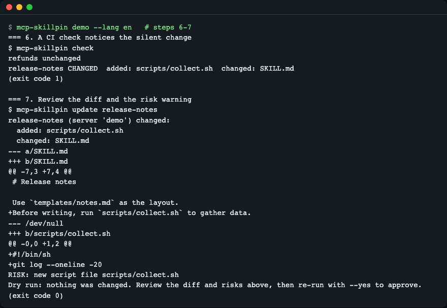
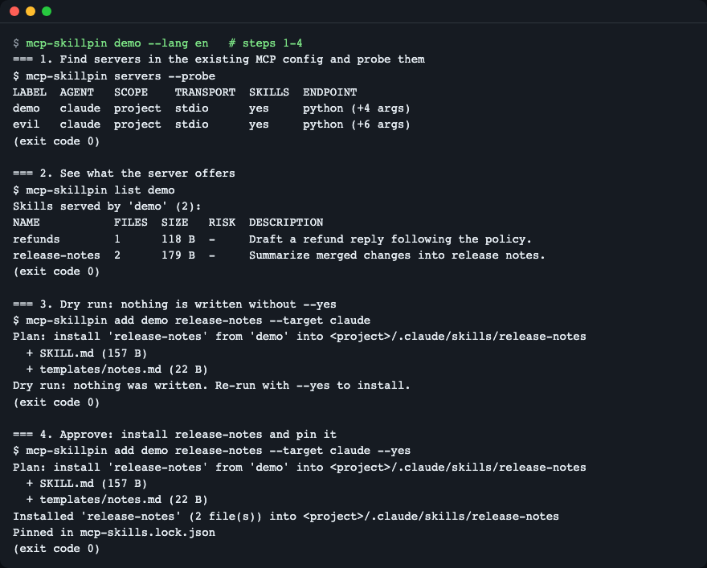
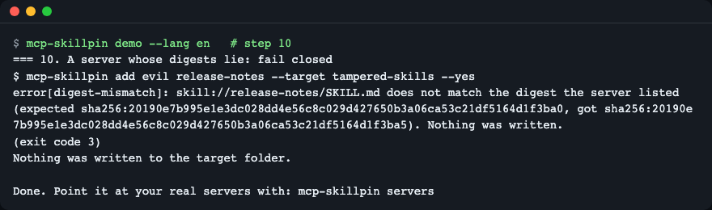
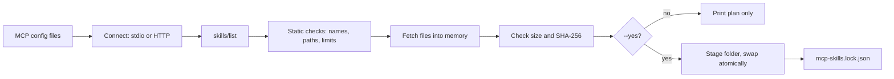

# mcp-skillpin

**English** | [한국어](README.ko.md)

Verify, pin and install the agent skills that your MCP servers serve through the Skills Extension (SEP-2640) into Claude Code and Codex skill folders. It checks every file against the SHA-256 digest the server listed, writes a lock file, and shows you a diff when the server changes a skill later.


*Step 6 and 7 of the built-in demo: the server quietly changed `release-notes`; `check` notices, `update` shows the diff and flags the new script.*

## Who it is for

- You registered an MCP server in Claude Code or Codex and the server now offers skills, but you do not want to copy `SKILL.md` files by hand.
- You want a skill from a remote server to be reviewed once, then frozen, so a later silent edit of its instructions is caught.
- You want a CI step that fails when a skill you depend on changed on the server (`mcp-skillpin check` exits with 1).

## Install

```bash
# uv (Python package manager): https://docs.astral.sh/uv/
curl -LsSf https://astral.sh/uv/install.sh | sh
uv tool install git+https://github.com/LeeGyeongPil/mcp-skillpin
```

Python 3.11 or newer. The only runtime dependency is `pyyaml`. A minimal Linux image needs `curl` and `git` for the two commands above.

## Quick start

```bash
mcp-skillpin demo
```

The screen is in English unless your locale is Korean; pick a language with `mcp-skillpin demo --lang ko`.

`demo` is a **practice mock mode**: it starts a small mock MCP server (not a real service) in a temporary folder and walks through the whole flow in about a second. The mock speaks the real protocol over stdio, so the client code really connects, verifies and installs. Nothing outside the temporary folder is touched. Against a real server the same steps work, but replies can be slower because they depend on that server and your network.

Steps 1 to 4 of the demo (find servers, list skills, dry run, approve):


*Nothing is written until you add `--yes`. The lock file `mcp-skills.lock.json` is created on the first approved install.*

A server that lies about its files is refused (step 10):


*`error[digest-mismatch]` and exit code 3. The target folder is not even created.*

## Usage

Run it from the project folder where your `.mcp.json` (Claude Code) or `.codex/config.toml` (Codex) lives.

| Command | What it does | Example |
|---|---|---|
| `servers [--probe]` | Lists MCP servers found in the config files; `--probe` connects and shows whether each offers skills | `mcp-skillpin servers --probe` |
| `list <server>` | Skills the server offers: file count, size (the `allowed-tools`/`hooks` risk is shown by `add` and `update`) | `mcp-skillpin list demo` |
| `add <server> <skill> --target T` | Verifies the skill. Dry run by default; `--yes` installs and pins it | `mcp-skillpin add demo release-notes --target claude --yes` |
| `check [name ...]` | Compares the server's current skill with the lock file; exit 1 if changed | `mcp-skillpin check` |
| `update [name ...]` | Shows the diff and risks of a changed skill; `--yes` approves and re-pins | `mcp-skillpin update release-notes --yes` |
| `verify` | Re-hashes the installed folders and compares them with the lock file | `mcp-skillpin verify` |
| `demo` | Whole flow against the practice mock server in a temporary folder | `mcp-skillpin demo` |

`add --yes` and `update --yes` refuse to overwrite local edits in an installed folder (`error[local-edits]`, exit 2); add `--discard-local` to overwrite them on purpose. `add` of a skill that is already pinned in another target stops with `error[target-changed]` (exit 2). Mistakes on the command line print `error[usage]` (exit 2) in your language, and a local disk that refuses a read or write prints `error[io-error]` (exit 2).

Common options: `--lang en|ko`, `--lock PATH` (default `./mcp-skills.lock.json`), `--json` (machine-readable output), `--timeout SECONDS` (default 30). `--version` prints the version.

`--target` is one of `claude` (`./.claude/skills`), `claude-user` (`~/.claude/skills`), `codex` (`./.agents/skills`), `codex-user` (`~/.agents/skills`) or any folder path.

Exit codes: `0` ok, `1` change found (`check`/`verify`), `2` usage or config error, `3` verification failed, `4` a grant is required, `5` connection or protocol error.

### Scenario 1: install one skill

```text
$ mcp-skillpin list demo
Skills served by 'demo' (2):
NAME           FILES  SIZE   RISK  DESCRIPTION
refunds        1      118 B  -     Draft a refund reply following the policy.
release-notes  2      179 B  -     Summarize merged changes into release notes.

$ mcp-skillpin add demo release-notes --target claude
Plan: install 'release-notes' from 'demo' into <project>/.claude/skills/release-notes
  + SKILL.md (157 B)
  + templates/notes.md (22 B)
Dry run: nothing was written. Re-run with --yes to install.

$ mcp-skillpin add demo release-notes --target claude --yes
...
Installed 'release-notes' (2 file(s)) into <project>/.claude/skills/release-notes
Pinned in mcp-skills.lock.json
```

The first command shows what is offered. The second is the plan: every file and its size, nothing written. Only the third one writes, after all checks passed. Folder name and lock file are created together; the lock file is meant to be committed to git.

### Scenario 2: detect a silent change in CI

```text
$ mcp-skillpin check
refunds unchanged
release-notes CHANGED  added: scripts/collect.sh  changed: SKILL.md
```

The exit code is 1, so a CI job fails. Run `mcp-skillpin update release-notes` to read the diff and the `RISK:` lines (new or changed scripts, executable-looking files, files starting with `#!`, nested `SKILL.md`, changed frontmatter keys such as `allowed-tools`), then re-run with `--yes` only if you accept the change.

### Scenario 3: someone edited the installed copy

```text
$ mcp-skillpin verify
release-notes MODIFIED  modified: SKILL.md
```

`verify` does not contact any server. It re-hashes the installed files and compares them with the lock file, exit 1 if they differ. `mcp-skillpin update release-notes --yes` will not silently replace your edits: it stops with `error[local-edits]` and lists the files. Save your edits elsewhere, then re-run with `--yes --discard-local`.

### Scenario 4: skills that widen permissions

If the skill's frontmatter has `allowed-tools` or `hooks`, installing needs an explicit `--grant allowed-tools` (or `--grant hooks`) after you read the skill. Without it the command stops with exit code 4. Changing the value later asks again.

## Configuration

Servers are read from `./.mcp.json`, `~/.claude.json`, `./.codex/config.toml` and `~/.codex/config.toml`. stdio servers (a `command` with `args`) and Streamable HTTP servers (a `url`, optional `headers`) are supported. A minimal `.mcp.json`:

```json
{
  "mcpServers": {
    "demo": {
      "command": "/path/to/python",
      "args": ["-m", "mcp_skillpin.mockserver", "--data", "v1"]
    }
  }
}
```

With that file, `mcp-skillpin list demo` talks to the practice mock server (use the Python that has `mcp-skillpin` installed). Replace it with your real server entry for real use. `${VAR}` and `${VAR:-default}` in values are expanded from the environment in the Claude Code JSON files (`.mcp.json`, `~/.claude.json`). In Codex `config.toml` files the text is passed through literally; use `bearer_token_env_var` there.

| Setting | Meaning | Default |
|---|---|---|
| `--lang en\|ko` | Screen language | `MCP_SKILLPIN_LANG`, then `LC_ALL`, `LC_MESSAGES`, `LANG`; English unless Korean |
| `--lock PATH` | Lock file location | `./mcp-skills.lock.json` |
| `--timeout SECONDS` | Per request limit | 30 |

No API key is needed. Bearer tokens in your server config are never printed, written to the lock file or stored in the skill folder. HTTP 401 and 403 are reported as `connect-failed`, and redirects are not followed so the `Authorization` header cannot leak.

Practice mock server options (`python -m mcp_skillpin.mockserver`): `--data v1|v2|<folder>`, `--http PORT`, `--sse`, `--page-size N`, `--legacy`, `--tamper digest|size|unlisted|frontmatter|name|traversal|limit|limit-size|dynamic|casefold|unicode|file-dir|file-dir-case|dir-case|reserved`.

## How it works



1. The client reads your existing Claude Code and Codex MCP settings. You do not configure a second list.
2. It talks the MCP 2026-07-28 protocol itself (`server/discover`, then `skills/list`, `skills/get`, `resources/read`), over stdio or Streamable HTTP.
3. Each skill entry is checked before any download: safe relative paths, name equal to the folder name, at most 512 files and 16 MiB.
4. Files are fetched into memory and checked against the listed size and SHA-256 digest, and against the `SKILL.md` frontmatter. A file the server returns that it did not list is a failure.
5. Only after every check passes does it write: to a staging folder first, then an atomic swap. A failed check leaves the target folder untouched; the tests assert that the skill folder is not even created for every tampering mode.
6. The lock file (sorted JSON, key `<server>/<skill>`) stores digests, sizes, URIs and grants. A small `.mcp-origin.json` in the skill folder records which server it came from.

This is explicit per-skill approval, not a cache: the default is a dry run, installed files have no executable bit, and `allowed-tools` and `hooks` need a separate `--grant`.

## When to use it

- Good fit: a skill comes from an MCP server you do not control, and you want review once, then a diff on every change.
- Good fit: you need a reproducible, committed record (`mcp-skills.lock.json`) of exactly which skill files you run.
- If you only need to read a skill from your own Python code, the MCP SDKs you already use may offer a client-side helper for the extension (FastMCP has one); this tool is the command-line workflow around it. Skills that live in a git repository or a package are better handled by the tooling of that ecosystem.
- The extension is specified in [SEP-2640](https://modelcontextprotocol.io/seps/2640-skills-extension) (checked 2026-11-16).
- This version does not support legacy servers that only speak the `initialize` handshake, OAuth, the old SSE transport, WebSocket, dynamic skills, or Windows (not tested).

## Troubleshooting

| Symptom | Cause | Fix |
|---|---|---|
| `error[no-servers]` | No `.mcp.json` or Codex config found from the current folder | Run from the project folder; the config is not searched in parent folders |
| `error[server-not-found]` | Label does not match | Run `mcp-skillpin servers` and use the `LABEL` column |
| `error[legacy-protocol]` | The server only speaks an older MCP protocol | Use a server that supports protocol 2026-07-28 |
| `error[no-skills-extension]` | The server does not declare the skills extension | Check the server's documentation; `servers --probe` shows `SKILLS no` |
| `error[digest-mismatch]` / `size-mismatch` | The server's files do not match what it listed | Nothing was written. Do not install; report it to the server's owner |
| `error[grant-required]` (exit 4) | The skill widens permissions | Read the skill, then add `--grant allowed-tools` or `--grant hooks` |
| `error[local-collision]` | The target folder exists and is not pinned by the lock file | Move it away or choose another `--target`; existing files are left untouched |
| `error[local-edits]` | You edited the installed copy and ran `add --yes` or `update --yes` | Save your edits elsewhere, then add `--discard-local` |
| `error[target-changed]` | The skill is already pinned in another target folder | Remove that folder first, or keep the same `--target` |
| `error[unsafe-path]` | The server listed an unsafe path, two paths that differ only by letter case or Unicode form (`SKILL.md` and `skill.md`), a file that is also a folder (`docs` and `docs/x.md`), two spellings of one folder (`ref/` and `REF/`), or the reserved name `.mcp-origin.json` | Nothing was written, and the message names the colliding paths. Ask the server's owner to rename one of them |
| `error[usage]` | A missing or unknown argument or command | Run the command shown in the hint (`--help`) |
| `error[io-error]` | The local disk refused a read or write (for example no permission) | Fix the permissions of the project folder or the `--target` folder |
| `error[connect-failed]` on HTTP | Credentials rejected (401/403) or the host is unreachable | Check `headers` in your config; redirects are not followed |
| `error[timeout]` | Slow remote server | Raise `--timeout` |
| `error[bad-config]` | A config file is unreadable (for example no permission) | Fix the file's permissions or run with access to it |

## Development

```bash
git clone https://github.com/LeeGyeongPil/mcp-skillpin
cd mcp-skillpin
uv sync --locked
uv run pytest
```

144 tests, using only local mock servers (and a FastMCP server for an interoperability check): no keys, no network beyond installing dependencies. Bugs and ideas are welcome as issues. Changes are listed in [CHANGELOG.md](CHANGELOG.md).

## License

MIT. See [LICENSE](LICENSE).
